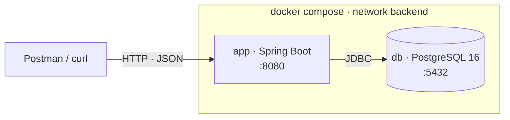

# Отчет по лабораторной работе «Разработка микросервиса»

**Студент:** Швецов Георгий Владимирович  
**Группа:** 8К31  
**Вариант:** 23  
**Преподаватель:** Коровкин  
**Дата:** 15.11.2026

---

## 1. Введение

### 1.1. Описание сценария

Команде разработки нужно было сделать небольшой внутренний сервис для учёта задач. Сервис должен принимать запросы по REST API, хранить данные в реляционной базе и разворачиваться вместе с ней одной командой. Отдельное требование — не «падать» на некорректных данных, а возвращать понятную ошибку с правильным HTTP-кодом.

В качестве полигона использовался локальный Docker Desktop на Windows. Приложение и PostgreSQL запускаются в отдельных контейнерах, связаны через docker-compose и общую сеть. Проверка выполнялась через curl и Postman, проект опубликован в GitHub.



### 1.2. Цели работы

- Реализовать микросервис минимум с четырьмя REST-запросами.
- Подключить реляционную СУБД.
- Собрать приложение в Docker-образ с multi-stage сборкой.
- Описать совместный запуск приложения и БД через docker-compose.
- Реализовать валидацию входных данных и централизованную обработку ошибок.
- Проверить работу через Postman.
- Разместить проект в GitHub с доступом для clone/fork.

### 1.3. Индивидуализация

- **Студент:** Швецов Георгий Владимирович.
- **Группа:** 8К31.
- **Вариант:** 23.
- **Проект:** `task-microservice`.
- **СУБД:** `taskdb`, пользователь `taskuser`.
- **Контейнеры:** `task-service-app`, `task-service-db`.

Индивидуальный признак `8k31-23-shvetsov` используется в отчёте и в описании работы; отдельного требования к именам контейнеров в задании не было, поэтому контейнеры названы по функциональному назначению.

---

## 2. Подготовка среды

### 2.1. Требования к стенду

| Ресурс | Значение |
|---|---|
| ОС | Windows 10 x64 |
| Docker | 29.1.2 |
| Docker Compose | v2.40.3 Desktop |
| Java в контейнере | Eclipse Temurin 21 |
| Сборка | Maven 3.9 (в контейнере) |
| СУБД | PostgreSQL 16 |
| Порт API | 8080 |
| Порт PostgreSQL | 5432 (внутри сети compose) |
| Инструмент проверки | Postman + curl |

Локально Maven не устанавливался: сборка выполняется внутри первого этапа Dockerfile. Это удобнее для воспроизводимости — на другой машине не нужно отдельно ставить JDK и Maven, достаточно Docker.

### 2.2. Проверка инструментов

```text
java -version
java version "26" 2026-03-17
Java(TM) SE Runtime Environment (build 26+35-2893)
Java HotSpot(TM) 64-Bit Server VM (build 26+35-2893, sharing)

docker --version
Docker version 29.1.2, build 890dcca

docker compose version
Docker Compose version v2.40.3-desktop.1

git --version
git version 2.45.1.windows.1
```

Локально стоит Java 26, но проект собирается и запускается на Java 21 в контейнере. Версия Java зафиксирована в `pom.xml` (`<java.version>21</java.version>`) и в базовых образах Dockerfile, поэтому результат не зависит от версии JDK на хосте.

### 2.3. Почему выбран такой стек

- **Java + Spring Boot** — быстро даёт готовый REST-контроллер, DI, JPA и валидацию без ручной настройки сервлета.
- **Spring Data JPA** — минимум кода для CRUD, репозиторий и транзакции.
- **PostgreSQL** — полноценная реляционная СУБД, хорошо работает в контейнере, легко проверяется через `psql`.
- **Docker + docker-compose** — приложение и БД запускаются одной командой, конфигурация описана в репозитории.
- **Postman** — наглядная проверка запросов и сохранение коллекции для повторного прогона.

---

## 3. Задачи и выполнение

### 3.1. Проектирование модели данных

В качестве предметной области выбраны задачи. Модель получилась небольшой, но достаточной для CRUD и фильтрации.

| Поле | Тип | Ограничения | Назначение |
|---|---|---|---|
| `id` | `Long` | PK, auto increment | Идентификатор |
| `title` | `String` | обязательное, 1–120 символов | Название задачи |
| `description` | `String` | до 1000 символов | Описание |
| `status` | `TaskStatus` | `NEW`, `IN_PROGRESS`, `DONE` | Статус |
| `priority` | `TaskPriority` | `LOW`, `MEDIUM`, `HIGH` | Приоритет |
| `createdAt` | `Instant` | заполняется при создании | Дата создания |
| `updatedAt` | `Instant` | обновляется при изменении | Дата изменения |

Статус и приоритет хранятся строками (`@Enumerated(EnumType.STRING)`), чтобы в БД было читаемое значение, а не порядковый номер.

### 3.2. Проектирование REST API

| N | Метод | Endpoint | Назначение | Код успеха |
|---|---|---|---|---|
| 1 | GET | `/api/tasks` | Список задач, фильтр `?status=NEW` | 200 |
| 2 | GET | `/api/tasks/{id}` | Задача по идентификатору | 200 |
| 3 | POST | `/api/tasks` | Создание задачи | 201 + `Location` |
| 4 | PUT | `/api/tasks/{id}` | Полное обновление | 200 |
| 5 | PATCH | `/api/tasks/{id}` | Частичное обновление | 200 |
| 6 | DELETE | `/api/tasks/{id}` | Удаление | 204 |

Получилось шесть запросов — больше минимальных четырёх. `PUT` заменяет все поля, `PATCH` меняет только переданные. `POST` возвращает заголовок `Location` со ссылкой на созданный ресурс.

### 3.3. Структура проекта

```text
task-microservice/
├── Dockerfile
├── docker-compose.yml
├── pom.xml
├── README.md
├── REPORT.md
├── postman/
│   └── Task-Microservice.postman_collection.json
└── src/main/
    ├── java/ru/tpu/microservice/
    │   ├── TaskMicroserviceApplication.java
    │   ├── domain/
    │   │   ├── Task.java
    │   │   ├── TaskStatus.java
    │   │   └── TaskPriority.java
    │   ├── dto/
    │   │   ├── CreateTaskRequest.java
    │   │   ├── UpdateTaskRequest.java
    │   │   ├── PatchTaskRequest.java
    │   │   └── TaskResponse.java
    │   ├── exception/
    │   │   └── TaskNotFoundException.java
    │   ├── repository/
    │   │   └── TaskRepository.java
    │   ├── service/
    │   │   └── TaskService.java
    │   └── web/
    │       ├── TaskController.java
    │       ├── ErrorResponse.java
    │       └── GlobalExceptionHandler.java
    └── resources/application.yml
```

Разделение по слоям: `domain` — сущность, `dto` — запросы и ответы API, `repository` — доступ к БД, `service` — бизнес-логика, `web` — контроллер и обработка ошибок.

### 3.4. Сущность и репозиторий

```java
@Entity
@Table(name = "tasks")
public class Task {

    @Id
    @GeneratedValue(strategy = GenerationType.IDENTITY)
    private Long id;

    @Column(nullable = false, length = 120)
    private String title;

    @Column(length = 1000)
    private String description;

    @Enumerated(EnumType.STRING)
    @Column(nullable = false, length = 20)
    private TaskStatus status = TaskStatus.NEW;

    @Enumerated(EnumType.STRING)
    @Column(nullable = false, length = 20)
    private TaskPriority priority = TaskPriority.MEDIUM;

    @Column(name = "created_at", nullable = false, updatable = false)
    private Instant createdAt;

    @Column(name = "updated_at", nullable = false)
    private Instant updatedAt;

    @PrePersist
    void onCreate() {
        Instant now = Instant.now();
        createdAt = now;
        updatedAt = now;
    }

    @PreUpdate
    void onUpdate() {
        updatedAt = Instant.now();
    }

    // getters и setters
}
```

Репозиторий — обычный Spring Data JPA:

```java
public interface TaskRepository extends JpaRepository<Task, Long> {

    List<Task> findAllByStatus(TaskStatus status, Sort sort);
}
```

Схема таблицы создаётся Hibernate автоматически (`spring.jpa.hibernate.ddl-auto=update`). Для учебного проекта этого достаточно; в production обычно используют Flyway или Liquibase.

### 3.5. Сервис и контроллер

Контроллер принимает HTTP-запросы, валидирует DTO и делегирует работу сервису:

```java
@RestController
@RequestMapping("/api/tasks")
public class TaskController {

    private final TaskService taskService;

    public TaskController(TaskService taskService) {
        this.taskService = taskService;
    }

    @GetMapping
    public List<TaskResponse> findAll(@RequestParam(required = false) TaskStatus status) {
        return taskService.findAll(status);
    }

    @GetMapping("/{id}")
    public TaskResponse findById(@PathVariable Long id) {
        return taskService.findById(id);
    }

    @PostMapping
    public ResponseEntity<TaskResponse> create(@Valid @RequestBody CreateTaskRequest request) {
        TaskResponse created = taskService.create(request);
        URI location = ServletUriComponentsBuilder.fromCurrentRequest()
                .path("/{id}")
                .buildAndExpand(created.id())
                .toUri();
        return ResponseEntity.status(HttpStatus.CREATED).location(location).body(created);
    }

    @PutMapping("/{id}")
    public TaskResponse update(@PathVariable Long id,
                               @Valid @RequestBody UpdateTaskRequest request) {
        return taskService.update(id, request);
    }

    @PatchMapping("/{id}")
    public TaskResponse patch(@PathVariable Long id,
                              @Valid @RequestBody PatchTaskRequest request) {
        return taskService.patch(id, request);
    }

    @DeleteMapping("/{id}")
    public ResponseEntity<Void> delete(@PathVariable Long id) {
        taskService.delete(id);
        return ResponseEntity.noContent().build();
    }
}
```

В сервисе `create`, `update` и `patch` помечены `@Transactional`. Для `PUT` и `PATCH` используется `saveAndFlush`, чтобы `@PreUpdate` успел обновить `updatedAt` до формирования ответа.

### 3.6. Валидация запросов

Входные DTO проверяются аннотациями Jakarta Validation:

```java
public record CreateTaskRequest(

        @NotBlank(message = "Поле 'title' обязательно и не может быть пустым")
        @Size(max = 120, message = "Поле 'title' не должно превышать 120 символов")
        String title,

        @Size(max = 1000, message = "Поле 'description' не должно превышать 1000 символов")
        String description,

        TaskStatus status,

        TaskPriority priority
) {
}
```

Если `title` пустой или слишком длинный, клиент получает 400 и карту `fieldErrors`. Неизвестное значение `status` или `priority` в JSON приводит к `HttpMessageNotReadableException` — оно тоже обрабатывается и возвращает 400 с подсказкой допустимых значений.

### 3.7. Обработка ошибок

Все исключения собраны в одном `@RestControllerAdvice`. Ответ имеет единый формат:

```json
{
  "timestamp": "2026-11-15T08:36:37.831045819Z",
  "status": 400,
  "error": "Bad Request",
  "message": "Ошибка валидации входных данных",
  "path": "/api/tasks",
  "fieldErrors": {
    "title": "Поле 'title' обязательно и не может быть пустым"
  }
}
```

| Ситуация | Исключение | HTTP-код |
|---|---|---|
| Ошибка валидации DTO | `MethodArgumentNotValidException` | 400 |
| Нарушение ограничений параметров | `ConstraintViolationException` | 400 |
| Невалидный JSON / неизвестный enum | `HttpMessageNotReadableException` | 400 |
| Неверный тип `id` в пути | `MethodArgumentTypeMismatchException` | 400 |
| Отсутствует обязательный параметр | `MissingServletRequestParameterException` | 400 |
| Задача не найдена | `TaskNotFoundException` | 404 |
| Конфликт с БД | `DataIntegrityViolationException` | 409 |
| Метод не поддерживается | `HttpRequestMethodNotSupportedException` | 405 |
| Неверный `Content-Type` | `HttpMediaTypeNotSupportedException` | 415 |
| Непредвиденная ошибка | `Exception` | 500 |

Фрагмент обработчика:

```java
@RestControllerAdvice
public class GlobalExceptionHandler {

    @ExceptionHandler(MethodArgumentNotValidException.class)
    public ResponseEntity<ErrorResponse> handleValidation(MethodArgumentNotValidException ex,
                                                          HttpServletRequest request) {
        Map<String, String> fieldErrors = new LinkedHashMap<>();
        ex.getBindingResult().getFieldErrors().forEach(error ->
                fieldErrors.putIfAbsent(error.getField(), error.getDefaultMessage()));

        ErrorResponse body = ErrorResponse.withFields(
                HttpStatus.BAD_REQUEST,
                "Ошибка валидации входных данных",
                request.getRequestURI(),
                fieldErrors
        );
        return ResponseEntity.badRequest().body(body);
    }

    @ExceptionHandler(TaskNotFoundException.class)
    public ResponseEntity<ErrorResponse> handleNotFound(TaskNotFoundException ex,
                                                        HttpServletRequest request) {
        ErrorResponse body = ErrorResponse.of(
                HttpStatus.NOT_FOUND,
                ex.getMessage(),
                request.getRequestURI()
        );
        return ResponseEntity.status(HttpStatus.NOT_FOUND).body(body);
    }
}
```

Главное: при некорректном запросе приложение не завершается. Оно возвращает JSON с кодом, сообщением и путём, а в лог пишет только непредвиденные ошибки.

### 3.8. Multi-stage Dockerfile

```dockerfile
# syntax=docker/dockerfile:1

# ---------- Этап 1: сборка ----------
FROM maven:3.9-eclipse-temurin-21 AS build

WORKDIR /workspace

# Сначала копируем только pom.xml — слой с зависимостями кешируется
COPY pom.xml .
RUN mvn -B -q -DskipTests dependency:resolve

# Затем исходники и сборка исполняемого jar
COPY src ./src
RUN mvn -B -q -DskipTests clean package

# ---------- Этап 2: запуск ----------
FROM eclipse-temurin:21-jre-alpine AS runtime

RUN addgroup -S app && adduser -S app -G app

WORKDIR /app
COPY --from=build /workspace/target/*.jar app.jar

USER app
EXPOSE 8080

ENTRYPOINT ["java", "-jar", "/app/app.jar"]
```

Первый этап — полноценный Maven-образ с JDK. Второй — только JRE на Alpine. В финальный образ не попадают Maven, исходники и кэш зависимостей, поэтому он весит около 382 MB, а не несколько сотен мегабайт с инструментами сборки. Приложение запускается от пользователя `app`, а не от root.

### 3.9. docker-compose

```yaml
name: task-microservice

services:
  db:
    image: postgres:16-alpine
    container_name: task-service-db
    environment:
      POSTGRES_DB: taskdb
      POSTGRES_USER: taskuser
      POSTGRES_PASSWORD: taskpass
    volumes:
      - pgdata:/var/lib/postgresql/data
    healthcheck:
      test: ["CMD-SHELL", "pg_isready -U taskuser -d taskdb"]
      interval: 5s
      timeout: 5s
      retries: 10
    networks:
      - backend

  app:
    build:
      context: .
      dockerfile: Dockerfile
    container_name: task-service-app
    environment:
      SPRING_DATASOURCE_URL: jdbc:postgresql://db:5432/taskdb
      SPRING_DATASOURCE_USERNAME: taskuser
      SPRING_DATASOURCE_PASSWORD: taskpass
    ports:
      - "8080:8080"
    depends_on:
      db:
        condition: service_healthy
    healthcheck:
      test: ["CMD", "wget", "-qO-", "http://localhost:8080/actuator/health"]
      interval: 10s
      timeout: 5s
      retries: 10
      start_period: 30s
    restart: unless-stopped
    networks:
      - backend

volumes:
  pgdata:

networks:
  backend:
    driver: bridge
```

Что здесь важно:

- `db` и `app` находятся в одной сети `backend`, поэтому приложение обращается к БД по имени `db`, а не по IP.
- `depends_on` с `condition: service_healthy` — приложение не стартует, пока PostgreSQL не пройдёт `pg_isready`.
- `pgdata` — named volume, данные не пропадают при перезапуске контейнеров.
- У приложения тоже есть healthcheck через Actuator, поэтому `docker compose ps` показывает `healthy`.
- Пароль `taskpass` — учебный, для реального проекта его выносят в `.env` или секреты.

### 3.10. Сборка и запуск

```bash
docker compose up -d --build
```

Фрагмент вывода:

```text
Container task-service-db  Creating
Container task-service-db  Created
Container task-service-db  Starting
Container task-service-db  Started
Container task-service-db  Waiting
Container task-service-db  Healthy
Container task-service-app  Starting
Container task-service-app  Started
```

Проверка состояния:

```bash
docker compose ps
```

| Сервис | Контейнер | Образ | Статус | Порты |
|---|---|---|---|---|
| `app` | `task-service-app` | `task-microservice-app` | `Up (healthy)` | `0.0.0.0:8080 → 8080` |
| `db` | `task-service-db` | `postgres:16-alpine` | `Up (healthy)` | `5432/tcp` |

Healthcheck приложения:

```bash
curl -s http://localhost:8080/actuator/health
```

```json
{"status":"UP","groups":["liveness","readiness"]}
```

### 3.11. Проверка API

Создание задачи:

```bash
curl -i -X POST http://localhost:8080/api/tasks \
  -H "Content-Type: application/json" \
  -d '{
        "title": "Подготовить отчёт",
        "description": "Собрать результаты за квартал",
        "status": "NEW",
        "priority": "HIGH"
      }'
```

Ответ `201 Created`:

```json
{
  "id": 2,
  "title": "Подготовить отчёт",
  "description": "Собрать результаты за квартал",
  "status": "NEW",
  "priority": "HIGH",
  "createdAt": "2026-11-15T08:36:36.993120597Z",
  "updatedAt": "2026-11-15T08:36:36.993120597Z"
}
```

Получение списка:

```bash
curl -s http://localhost:8080/api/tasks
```

```json
[
  {
    "id": 2,
    "title": "Подготовить отчёт",
    "description": "Собрать результаты за квартал",
    "status": "NEW",
    "priority": "HIGH",
    "createdAt": "2026-11-15T08:36:36.993121Z",
    "updatedAt": "2026-11-15T08:36:36.993121Z"
  }
]
```

Обновление через `PUT`:

```bash
curl -s -X PUT http://localhost:8080/api/tasks/2 \
  -H "Content-Type: application/json" \
  -d '{
        "title": "Подготовить квартальный отчёт",
        "description": "Обновлённое описание",
        "status": "IN_PROGRESS",
        "priority": "MEDIUM"
      }'
```

Ответ `200 OK`:

```json
{
  "id": 2,
  "title": "Подготовить квартальный отчёт",
  "description": "Обновлённое описание",
  "status": "IN_PROGRESS",
  "priority": "MEDIUM",
  "createdAt": "2026-11-15T08:36:36.993121Z",
  "updatedAt": "2026-11-15T08:36:37.586183775Z"
}
```

Частичное обновление через `PATCH`:

```bash
curl -s -X PATCH http://localhost:8080/api/tasks/2 \
  -H "Content-Type: application/json" \
  -d '{"status": "DONE"}'
```

Ответ `200 OK`:

```json
{
  "id": 2,
  "title": "Подготовить квартальный отчёт",
  "description": "Обновлённое описание",
  "status": "DONE",
  "priority": "MEDIUM",
  "createdAt": "2026-11-15T08:36:36.993121Z",
  "updatedAt": "2026-11-15T08:36:37.670078047Z"
}
```

Удаление:

```bash
curl -i -X DELETE http://localhost:8080/api/tasks/2
```

Ответ `204 No Content`, тело отсутствует. Повторный `GET /api/tasks/2` возвращает `404`.

Сводка проверок:

| Сценарий | Код | Результат |
|---|---|---|
| POST корректной задачи | 201 | задача создана, есть `id` и `Location` |
| GET списка | 200 | массив задач |
| GET по id | 200 | задача найдена |
| PUT | 200 | все поля заменены |
| PATCH | 200 | изменён только статус |
| DELETE | 204 | задача удалена |
| POST с пустым `title` | 400 | `fieldErrors.title` |
| POST с `status: UNKNOWN` | 400 | сообщение о допустимых значениях |
| GET `?status=UNKNOWN` | 400 | ошибка параметра |
| GET `/api/tasks/abc` | 400 | ошибка типа `id` |
| GET `/api/tasks/999999` | 404 | задача не найдена |
| GET удалённой задачи | 404 | задача не найдена |

Пример ошибки валидации:

```json
{
  "timestamp": "2026-11-15T08:36:37.831045819Z",
  "status": 400,
  "error": "Bad Request",
  "message": "Ошибка валидации входных данных",
  "path": "/api/tasks",
  "fieldErrors": {
    "title": "Поле 'title' обязательно и не может быть пустым"
  }
}
```

Пример ошибки 404:

```json
{
  "timestamp": "2026-11-15T08:36:37.938996663Z",
  "status": 404,
  "error": "Not Found",
  "message": "Задача с id=999999 не найдена",
  "path": "/api/tasks/999999"
}
```

### 3.12. Postman

Коллекция лежит в `postman/Task-Microservice.postman_collection.json`. В ней 10 запросов:

1. Создание задачи.
2. Получение всех задач.
3. Фильтр по статусу `NEW`.
4. Получение задачи по `id`.
5. Полное обновление `PUT`.
6. Частичное обновление `PATCH`.
7. Удаление.
8. Ошибка 400 — пустой `title`.
9. Ошибка 400 — неизвестный статус.
10. Ошибка 404 — несуществующая задача.

Коллекция использует переменные `baseUrl` (`http://localhost:8080`) и `taskId`. После создания задачи тест-скрипт сохраняет `id` в `taskId`, поэтому последующие запросы работают с только что созданной задачей. Для запросов есть проверки статусов и полей ответа.

Порядок проверки: импортировать коллекцию, выполнить запросы по порядку, убедиться, что все тесты зелёные.

### 3.13. Публикация в GitHub

Проект опубликован в публичном репозитории:

```text
https://github.com/Obure22/task-microservice
```

Ветка `master`, основные коммиты:

```text
bd5e620 Уточнена ссылка для клонирования репозитория
4240128 Добавлен отчёт по лабораторной работе
dd2d2e0 Лабораторная работа: REST-микросервис задач на Java, PostgreSQL и Docker
```

Проверка клонирования:

```bash
git clone https://github.com/Obure22/task-microservice.git
cd task-microservice
```

Клонирование выполняется успешно, репозиторий публичный, доступны clone и fork.

### 3.14. Соответствие требованиям

| N | Требование | Реализация |
|---|---|---|
| 1 | Минимум 4 запроса | 6 запросов: GET, GET by id, POST, PUT, PATCH, DELETE |
| 2 | Любой язык | Java 21, Spring Boot 3.3.5 |
| 3 | Реляционная СУБД | PostgreSQL 16, Spring Data JPA |
| 4 | Совместное развёртывание в Docker | Два контейнера: `app` и `db`, общая сеть |
| 5 | docker-compose + multi-stage | `docker-compose.yml`, двухэтапный `Dockerfile` |
| 6 | GitHub/GitLab с clone/fork | Публичный репозиторий GitHub |
| 7 | Проверка через Postman | Коллекция из 10 запросов с тестами |
| 8 | Обработка ошибок | `GlobalExceptionHandler`, коды 400/404/405/409/415/500 |

---

## 4. Использование ИИ

При выполнении работы ИИ использовался как вспомогательный инструмент:

- генерация каркаса Spring Boot-приложения и структуры пакетов;
- подготовка DTO, аннотаций валидации и обработчика исключений;
- проверка Dockerfile и docker-compose;
- подготовка Postman-коллекции;
- оформление README и этого отчёта.

Что проверялось вручную:

- сборка образа и запуск контейнеров;
- статусы контейнеров и healthcheck;
- все HTTP-запросы и коды ответов;
- содержимое JSON-ответов и сообщений об ошибках;
- push в GitHub и контрольное клонирование.

В процессе пришлось исправить пару технических мелочей: на Windows файлы сначала создались с нижним регистром (`task.java`, `dockerfile`), что сломало бы сборку на Linux; имена привели к нужному регистру. Ещё `updatedAt` в ответе `PUT` сначала оставался старым, пока не заменили `save` на `saveAndFlush`, чтобы `@PreUpdate` срабатывал до формирования ответа. Эти ошибки не попали в финальную версию.

---

## 5. Вывод

В ходе работы я реализовал REST-микросервис на Java 21 со Spring Boot и PostgreSQL. Сервис поддерживает шесть запросов: создание, получение списка и одной задачи, полное и частичное обновление, удаление. Данные хранятся в PostgreSQL, схема создаётся Hibernate, доступ к БД идёт через Spring Data JPA.

Приложение и база разворачиваются совместно через docker-compose. Сборка выполнена в multi-stage Dockerfile: Maven-этап собирает jar, runtime-этап запускает его на JRE от непривилегированного пользователя. Healthcheck PostgreSQL не даёт приложению стартовать раньше БД, а healthcheck Actuator показывает состояние самого сервиса.

Отдельно проверена обработка ошибок: пустой `title`, неизвестный статус, неверный тип `id`, несуществующая задача и удалённая задача возвращают 400 или 404 с понятным JSON-сообщением, приложение при этом продолжает работать. Все сценарии прогнаны через curl и Postman, коллекция сохранена в репозитории.

Проект опубликован в GitHub, клонирование и fork доступны. Работа показала, что для небольшого сервиса достаточно Spring Boot + JPA + PostgreSQL, а Docker-compose сильно упрощает воспроизводимый запуск. Основная сложность была не в коде, а в аккуратности: регистр имён файлов, порядок этапов сборки, healthcheck и единый формат ошибок. В целом мероприятие полезное, отношусь положительно.

---

**Дата сдачи:** 15.11.2026  
**Подпись студента:** _________________
